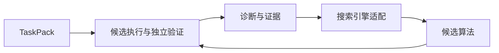

# ai4math课程作业——PathWeaver

**面向可验证组合优化问题的算法发现框架。**

[当前状态](STATUS.md) · [公开路线图](ROADMAP.md) · [变更记录](CHANGELOG.md) · [接口设计](docs/taskpacks.md) · [上游来源](docs/upstream.md)

PathWeaver 的目标是让同一个研究核心为不同任务生成候选算法、运行实验、分析失败并修正方法。任务通过 TaskPack 提供实例、约束、目标和独立验证。

**当前版本为早期开发骨架。** 已提供轻量 Python 包、通用类型接口和离线 CLI；搜索引擎适配、任务实现和实验执行仍在开发中。当前没有已发布的算法发现或性能改进结果。

## 快速开始

```bash
git clone https://github.com/yiwenxx/ai4math-coursework-pathweaver.git
cd ai4math-coursework-pathweaver
python -m venv .venv
# PowerShell: .venv\Scripts\Activate.ps1
# Linux/macOS: source .venv/bin/activate
python -m pip install -e .
pathweaver info
pathweaver tasks --json
```

支持 Python 3.11–3.13。当前包没有第三方运行依赖，上述入口均可离线运行。任务目录暂为空，尚未提供求解、验证或模型调用命令。

## 架构方向



```text
src/pathweaver/
├── cli.py              离线信息入口
├── core/contracts.py   TaskPack、求解预算、评估与证据类型
└── tasks/catalog.toml  公开任务目录
docs/                   公开设计与来源
.github/                构建 CI、Issue 与 PR 模板
```

后续开发会逐步发布可运行模块、公开任务和可重放的实验产物。算法输出由独立程序检验，评估状态会与证据一同记录。

## 持续开发

通过 [Issues](https://github.com/yiwenxx/ai4math-coursework-pathweaver/issues)、[Pull requests](https://github.com/yiwenxx/ai4math-coursework-pathweaver/pulls) 和变更日志查看已发生的变化。公开路线图描述功能方向，具体完成情况以代码和构建结果为准。

欢迎提交可复现的问题、接口建议和改进 PR，参见 [贡献说明](CONTRIBUTING.md)。

本项目采用 Apache-2.0。参考的开源项目保留各自版权，见 [上游来源](docs/upstream.md)。
